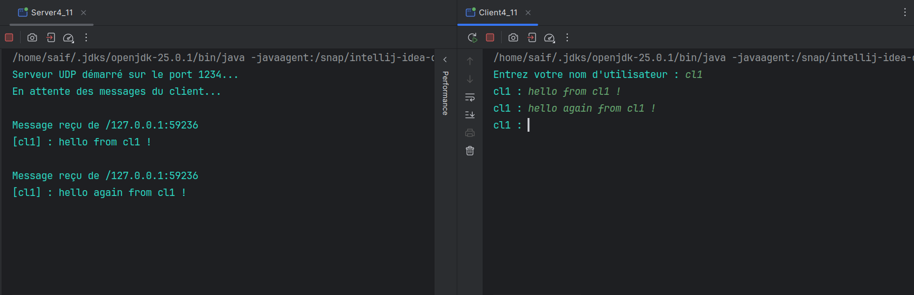
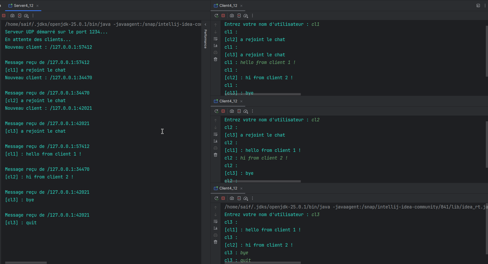

# TP4 : Sockets en mode non-connecté UDP
### Activité : Echange des datagrammes entre C/S en mode non-connecté 
### Service de chat C/S avec UDP 

## Activité 1

### Activité 1-1

### Activité 1-2
 

